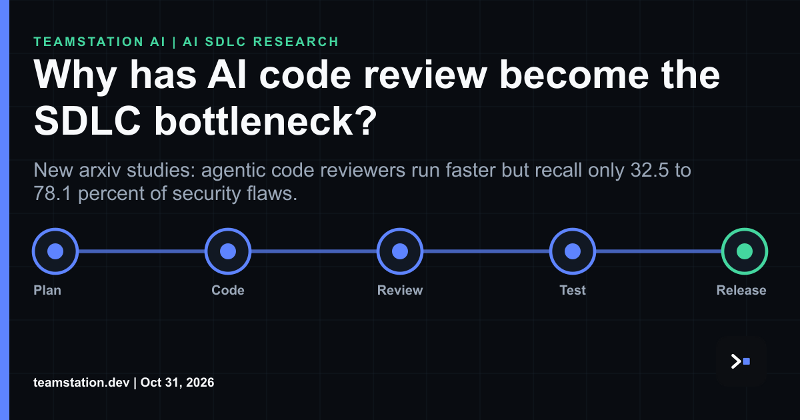

# AI Code Review Hit The Wall: What CTOs Need To Watch

The queue moves. Risk sits still. That's the pattern we keep seeing with AI code review, and it kinda explains why so many engineering leaders feel like velocity is up while incidents stay flat or worse.

A study of 1.02 million reviewed pull requests across 207 GitHub projects, spanning human-centric, LLM-assisted and agentic review eras, found that agent-involved review decisions ran faster. Review quality did not improve. The authors (Zhong, Noei, Adams and Zou on arXiv) basically watched three eras of review play out at scale, and the throughput gain never translated into fewer defects slipping through.

tbh that's the part leadership tends to miss. Dashboards show healthier cycle time. Production tells a different story. SecPRBench, built from 265 real bug-introducing commits across nine critical systems including Firefox, V8 and OpenSSL, pressure tested eight frontier models. Recall landed between 32.5% and 78.1%, with Grok 4.6 and GPT-6 sol at the top end. Even the best reviewers miss. When they miss, in 68% of cases they still flag the correct file but reason about a different mechanism. The agent looks engaged. The vulnerability survives the merge.

Security harnesses move the dial in opposite directions. OpenAI's Codex Security dropped recall by 8.3 points by abstaining more often. Anthropic's Defending Code lifted recall 7.7 points at higher cost. imo that's the clearest signal yet that this is a capacity planning problem, not a model problem.

Mining 36,710 software repositories turned up only 217 with autonomous agent loops in version control. Everyone talks about loop engineering. Almost nobody governs it. A position paper from CMU, Princeton and allied labs nails the shift: the real bottleneck has moved from raw capability to how teams communicate with, supervise and trust the agents. You gotta build the control plane around that.

For CTOs and CIOs, this is a legit shift. You need [**agentic AI review capacity planning**](https://teamstation.dev/research/articles/agentic-ai-review-capacity) and a way to [**measure engineering review drag capacity**](https://teamstation.dev/research/articles/engineering-review-drag-capacity-balance). fyi the leaders who get in front of this super early will own the next cycle. Full read here: <https://www.linkedin.com/pulse/why-has-ai-code-review-become-sdlc-bottleneck-teamstation-nkdfc/>
