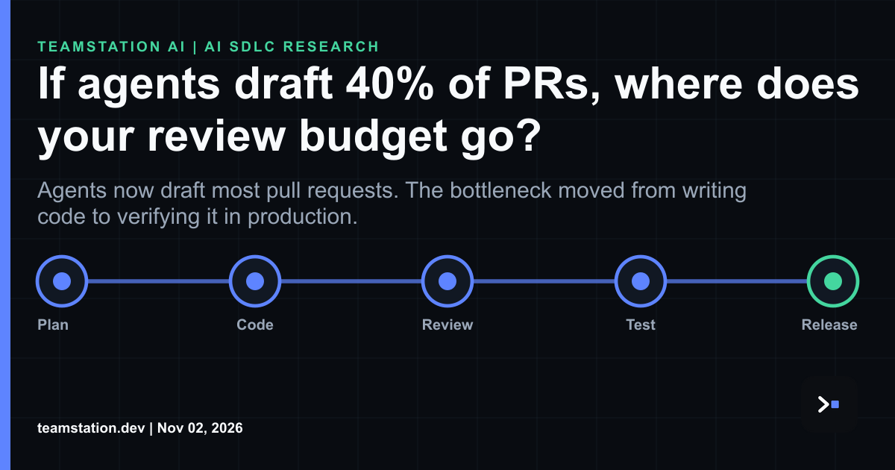

# Your Review Budget Just Got a New Line Item

Here's the thing about September 2026. Agents started 110 million pull requests on GitHub, which is about 6x the March volume. More than 40% of PRs on GitHub kicked off with an agent first draft, up from 17% in March. If you're a CTO or CIO still budgeting review as headcount per thousand lines of code, that math isn't going to work. It funds the wrong decade.

Our new article argues your review budget is kinda done bankrolling humans squinting at diffs. It reshapes into a verification stack: agent reviewers, replay sandboxes, a security lane, and humans adjudicating the thorny calls. The risk slid from "did a dev type a bug" to "did an agent, wielding live tool permissions, slip a bug past our other agents." Capital follows risk, and tbh the risk moved.

Why does this matter for CTOs and CIOs? Three reasons, imo. First, verdict only metrics overstate security value. On 31 held out malicious pull requests, CodeRabbit blocked 24 but identified the actual target vulnerability in only 16. You can't manage what you're measuring wrong. Second, security related agentic PRs show lower merge rates and longer review latency than non security agentic PRs, from a study of over 33,000 agentic PRs. The queue has a shape, and you've gotta staff for it. Third, adaptive feedback guided revision attacks reach success rates 2.5x and 12.5x those of the strongest evaluated text or comment based attacks against Sonnet 5 and GPT 5.5 reviewers. Reviewers get probed. Plan accordingly, naturally.

The research around the agentic SDLC names a Verification Tax that absorbs much of the raw generation speedup. You're not buying code faster. You're buying a different cost curve. That's a super real line item. Shift budget into agent reviewers, sandboxes, and a security lane. We've written about [**how to evaluate coding agent skills**](https://teamstation.dev/research/articles/agentic-ai-sdlc-test-skills-your-team-ships) and [**scaling code review for AI agents**](https://teamstation.dev/research/articles/agentic-ai-review-capacity). Full piece, fyi: <https://www.linkedin.com/pulse/agents-draft-40-prs-where-does-your-review-budget-go-teamstation-fxifc/>
