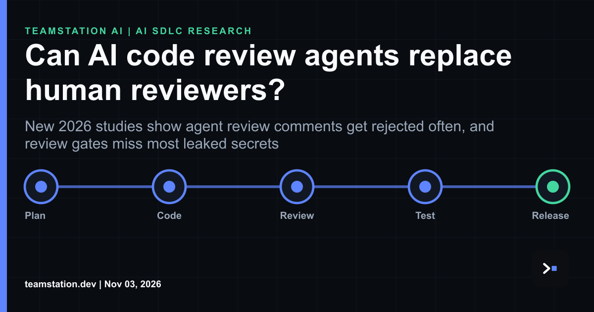

# Engineering note: AI review agents are a smoke detector, not a signoff

Today's LinkedIn article asks a plain question: can AI code review agents replace human reviewers? Our answer's no, and the research backs that up. Read it here: <https://www.linkedin.com/pulse/can-ai-code-review-agents-replace-human-reviewers-teamstation-x85zc/>

Here's the data we kept coming back to. In a study of 31,073 pairs of CodeRabbit agentic code reviews and developer feedback from 10,191 pull requests across 239 GitHub repositories, 36.4% of agentic reviews were accepted, 7.3% triggered discussion and 56.3% were rejected. So more than half the comments get tossed. That's kinda the whole story in a sentence, tbh.

It gets more interesting. Lightweight learning-based methods predicted rejection of agentic review comments with up to 76% F1 score, so the noise is predictable and you can filter it. Card sorting of 470 unresolved discussions found incorrect suggestions and intentional design decisions were the most common reasons comments stayed unresolved. The agent can't see why your team made a call. Naturally, a person can.

Security's where a CTO or CIO should get super uncomfortable. Across 16,112 file changes in 4,022 agent-generated pull requests, 38.9% of the PRs contained at least one security smell, and supply chain integrity issues made up 82.3% of detected security smells. Human collaborators introduced 67.6% of genuine leaked secrets in agent-assisted workflows, and existing automated and human review processes failed to detect 81.1% of those credentials before integration. Auto-fix loops aren't free either: remediation introduced new vulnerabilities in 15-22% of cases, and roughly 70% of those involved a single new finding.

What it means for engineering leadership, imo:
Treat the agent as a first sweep that routes attention, not as a gate.
Keep an accountable human on the merge button for anything touching dependencies, secrets or auth.
Budget reviewer hours on purpose. Our notes on [**AI agent code review capacity planning**](https://teamstation.dev/research/articles/agentic-ai-review-capacity) walk through how.
Test the tests. [**Mutation testing AI written code**](https://teamstation.dev/research/articles/mutation-testing-ai-generated-code) shows whether your suite's legit or just decorative.

You've gotta staff the signature, not just the scanner. The agent points. A person signs.
