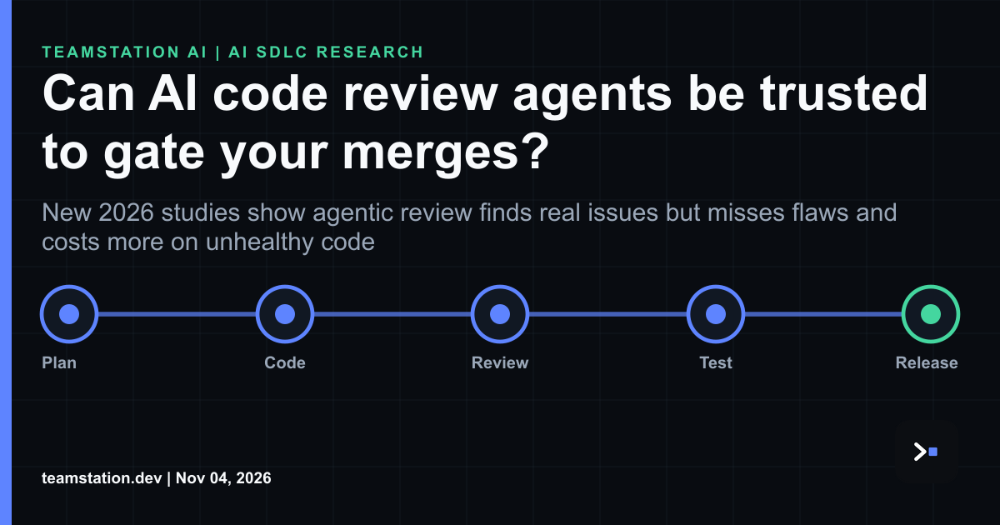

# Engineering note: AI review agents at the merge gate

Short version: not yet, and not alone. That's where today's LinkedIn article lands, and imo it's the right call for any CTO or CIO wiring an AI reviewer into branch protection.

The evidence kinda settles it. On the SecPRBench security review benchmark, recall across eight frontier models ranged from 32.5% to 78.1%. That spread is super wide for something you'd let block a merge. Worse, in 68% of missed vulnerabilities the review agent reported on the file that held the flaw but argued for a different mechanism. Right file, wrong story. You can't take that reviewer at its word.

The harness moves the needle too. OpenAI's Codex Security lowered recall by 8.3 points, mostly by abstaining, while Anthropic's Defending Code harness raised it by 7.7 points at a higher cost. So you aren't buying a model. You're buying a model plus a wrapper, and the wrapper legit changes the result.

Code shape matters as well. Across 465 agent-authored PRs and three LLMs, each CodeHealth point was associated with 3.5% to 6.1% lower token cost for agentic review and fix. Cleaner code is cheaper to review, for people and for agents. Naturally.

There's real upside here. Ericsson's multi-agent code review solution achieved 96% accuracy in correctly identifying issues in the code commits studied, and around 69% of correctly identified issues were rated important: approximately 33% severe issues that must be fixed and 36% important issues that should be fixed. Then again, in a production healthcare platform built with coding agents, the tests, monitors and reviewing agents used to supervise the system turned out to be fallible.

What we'd do: make the agent a fallible required check sitting among several others, calibrate it on your own repos, and keep a human approver who signs. You gotta measure it before you lean on it. Fyi, we've written up the capacity side in [**agentic AI code review capacity**](https://teamstation.dev/research/articles/agentic-ai-review-capacity).

Full article: <https://www.linkedin.com/pulse/can-ai-code-review-agents-trusted-gate-your-merges-teamstation-5dgjc/>
