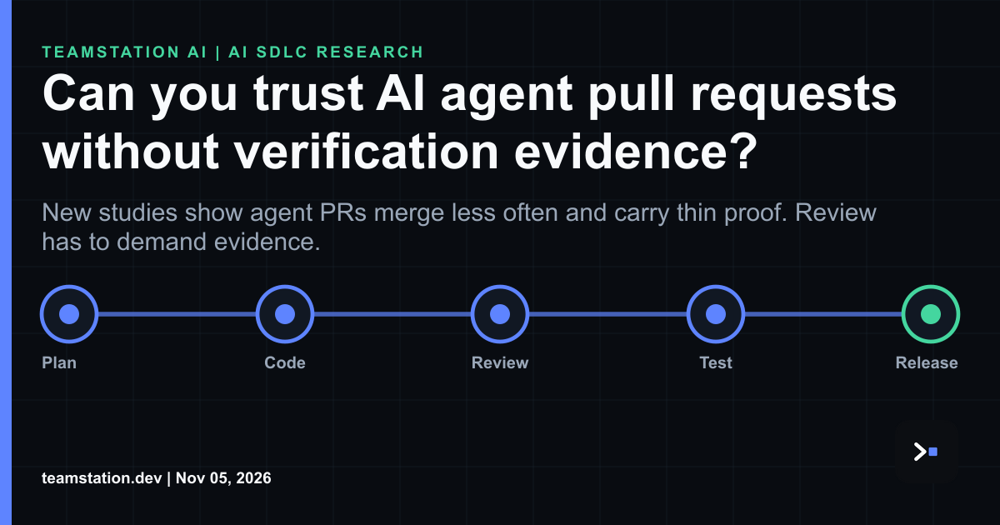

# Agent PRs need receipts, not vibes

Today's LinkedIn article asks a blunt question: can you trust AI agent pull requests without verification evidence? Read it here: <https://www.linkedin.com/pulse/can-you-trust-ai-agent-pull-requests-without-verification-ztvgc/> My answer's no, and the data backs me up.

Agentic performance PRs are merged less often than human-authored PRs (54.4% vs. 73.3%), even though both groups report validation at comparable rates. So reviewers aren't rejecting the claim of validation. They're rejecting what sits behind it. Agentic PRs lean more on static reasoning and less on benchmarks (46.1% vs. 57.2%), although benchmark use converges by the end of the study period. Across both groups, about half of validated PRs report no quantitative performance metric, and trade-offs are rarely quantified. That's legit a shared problem.

It gets kinda worse upstream. Instruction files and working notes account for 60.5% of coding agents' documentation interactions, versus 10.6% for classical technical documentation and 1.3% for API references. No explicit documentation-based validation sequence was observed, and documentation consultation is associated with less immediate testing (lift 0.23, adjusted OR 0.39). The agent reads the notes, feels done and skips the test. We've all worked with that engineer.

So what's it mean for a CTO or CIO? Tbh, the merge button needs a contract. Every agent PR should carry evidence you can check: the test run, the benchmark, the metric, the trade-off. If the PR can't show it, it's a draft. I'd treat [**agentic OpenAPI as operating evidence**](https://teamstation.dev/research/articles/agentic-openapi-as-engineering-operating-evidence), because a spec your pipeline verifies beats a commit message your reviewer squints at.

The harness counts too. In a harness study of 176 matched settings, context management got more valuable as the context-window budget tightened, mostly by preventing context-overflow failures. Planning shifted from an accuracy scaffold for weaker models to a cost saver for stronger models, with little change in accuracy. Imo your harness is a control surface, so tune it on purpose.

You've gotta budget for review as well, since [**AI agent code review capacity**](https://teamstation.dev/research/articles/agentic-ai-review-capacity) is where agent output piles up. Super unglamorous. Super real.

Fyi, none of this means slow down. It means stop merging wishes.

#AISDLC #SoftwareEngineering #CTO #AIEngineering #EngineeringLeadership
