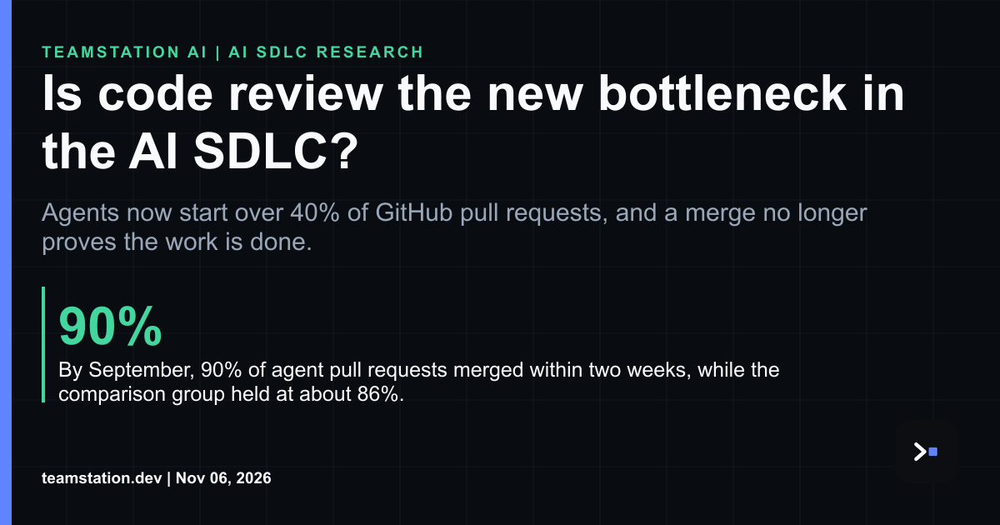

# Code review's the control point now

Today's LinkedIn article asks whether code review is the new bottleneck in the AI SDLC. Our answer is yes, and imo that bottleneck is the good news. It's the last merge gate where a person can still refuse a change, so snaking it like a clogged drain is kinda the wrong reflex.

Read it here: <https://www.linkedin.com/pulse/code-review-new-bottleneck-ai-sdlc-teamstation-kw8fc/>

Start with volume. By September 2026, more than 40% of pull requests on GitHub started with an agent's first draft, up from 17% in March. GitHub describes its agent signal as a floor because not all agent use may be detected, so fyi, treat that share as a minimum.

Then look at where the cost landed. At one mid-sized software company with a 2x mandate, load per reviewer doubled and automated review overtook human review in coverage within months of the mandate. PR throughput reached the target only in the tenth month.

Quality's the harder part. Merged agent PRs attract verified fixes at 1.62 times the odds of merged human PRs in the same repositories, and 69.6% of verified fixes in agent merges come from the same agent. That's an author grading its own homework. When researchers re-executed 30 merged agent performance fixes, 18 met their delivery criterion, 3 fell short of the claim, 9 showed no significant gain or regressed, and 14 changed behavior on untested inputs. A clean merge doesn't prove the claim held up.

Machines reviewing machines isn't a forecast either. A public dataset study identified 248,641 unique AI-attributed PRs that received at least one AI-attributed review.

So what's a CTO or CIO supposed to do? You've gotta plan review as capacity. Decide which changes need a person who can say no, track reviewer load like any constrained resource, and ask for re-execution evidence when a PR claims a gain. Our notes on [**measuring engineering review drag and capacity**](https://teamstation.dev/research/articles/engineering-review-drag-capacity-balance) get into the mechanics. Tbh, a super fast merge queue won't save you here, and legit control comes from staffing that gate on purpose.

#AISDLC #SoftwareEngineering #CTO #EngineeringLeadership
