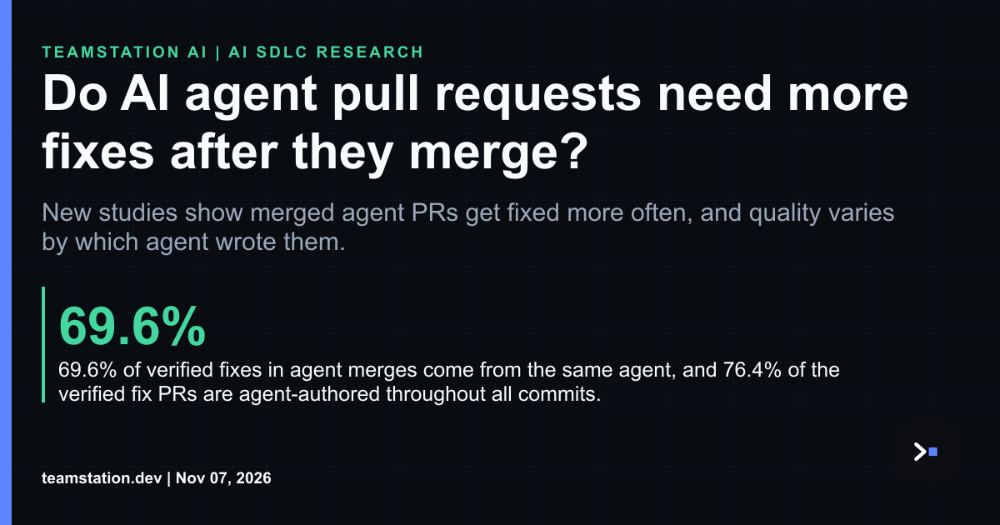

# Agent PRs, merge day, and the rework nobody budgeted for

Today's LinkedIn article asks a simple question: do AI agent pull requests need more fixes after they merge? Short answer, mostly yes. Full piece here: <https://www.linkedin.com/pulse/do-ai-agent-pull-requests-need-more-fixes-after-merge-teamstation-riybc/>

The headline finding's kinda blunt. Merged agent PRs attract verified fixes at 1.62 times the odds of merged human PRs in the same repositories over the same period of time. The agents also clean up after themselves a lot: 69.6% of verified fixes in agent merges come from the same agent, and 76.4% of the verified fix PRs are agent-authored throughout all commits. The study followed 6,774 merged agent PRs across five AI coding agents from repositories with at least 500 stars, against a baseline of 5,044 contemporaneous human PRs from the same repositories.

Here's where it gets legit interesting for a CTO or CIO. Vendor matters. Codex-authored PRs were reverted about half as often as human PRs (6.1% vs. 11.5%, odds ratio 0.50), while Devin PRs were reverted more often (14.5%, odds ratio 1.31). Pooled agent code was also less likely than human code to contain a security smell (odds ratio 0.63), driven by fewer hardcoded credentials and eval-style constructs. So this isn't a simple good or bad story.

The part I'd watch is review load. Copilot PRs drew the most human reviews and change requests, and Claude Code PRs waited the longest for a first human review (median 12.6 hours). That wait's where rework curdles. Somebody tired is soaking it up, and they're usually your strongest reviewers.

Meanwhile, AI reviewing AI keeps growing. A dataset of AI-to-AI code review contains 248,641 unique AI-attributed PRs that received at least one AI-attributed review. Cross-product AI-to-AI review occurred in approximately 1.6% of identified agent-authored PRs, but its volume increased by more than two orders of magnitude from 2025-Q1 to 2025-Q3.

What you've gotta do, imo, is treat review as capacity you plan, not slack you assume. We've written about [**AI agent code review capacity**](https://teamstation.dev/research/articles/agentic-ai-review-capacity) and [**how mutation testing catches AI defects**](https://teamstation.dev/research/articles/mutation-testing-ai-generated-code). Tbh the defect count's the easy number. Queue time and who absorbs it are the super expensive ones, and naturally they don't show up on the vendor slide.
