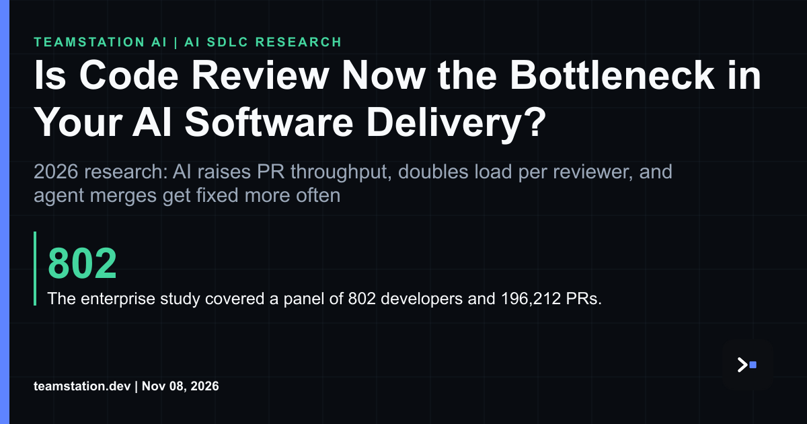

# Review is the new bottleneck in AI delivery

Agents made authoring nearly free. Verification still leans on human attention, so writing got cheap and checking didn't. We've pushed the constraint downstream to the review stage, and review doesn't scale the way GPUs do. Picture a short-order cook watching the ticket printer spit out orders faster than one grill can sear them.

Here's what the research says. In an enterprise that mandated doubling merged PRs per engineer with AI, PR throughput rose by about 12% when each developer started using AI and kept growing with use. The target was reached only in the tenth month. The cost landed on code review: load per reviewer doubled, and within months automated review overtook human review in coverage. That study covered a panel of 802 developers and 196,212 PRs, so it's legit data, not an anecdote.

Quality signals are kinda mixed too. Merged agent PRs attract verified fixes at 1.62 times the odds of merged human PRs in the same repositories, and 69.6% of verified fixes in agent merges come from the same agent. Agentic performance PRs get merged less often than human-authored ones (54.4% vs. 73.3%), even though both groups use similar optimization strategies. About half of validated PRs in both groups report no quantitative performance metric, and trade-offs are rarely quantified.

Acceptance can be predicted from submission-time signals with F1 scores above 0.95, but review effort depends mostly on reviewer availability, workflow and team review practice. Translation for a CTO or CIO: you can't model your way out of a staffing problem. You gotta plan [**human code review capacity for AI agents**](https://teamstation.dev/research/articles/agentic-ai-review-capacity) the same way you plan compute, and check your setup with [**human and AI agent team topology testing**](https://teamstation.dev/research/articles/human-task-agent-alignment-stress-test).

I'd start small, tbh. Measure reviewer load, watch where queues form, and decide which merges truly need a human. That's the super practical first move, imo, and fyi it's cheaper than the incident you'd otherwise explain later.

Full article: <https://www.linkedin.com/pulse/code-review-now-bottleneck-your-ai-software-delivery-teamstation-losic/>
