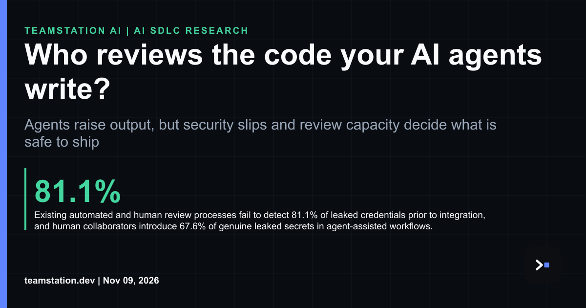

# Who reviews the code your AI agents write?

Here's the thing, and imo it's the part most teams skip. Somewhere along the way, everybody started assuming somebody scrutinizes every line. Right now, it's usually a frazzled person skimming a diff at the tail end of a long day, and that's kinda the whole problem. It isn't their fault. They've got no hours left to do the job properly.

The sourced numbers are legit uncomfortable. 38.9% of agent-generated PRs contain at least one security smell, with supply chain integrity issues accounting for 82.3% of all detected security smells. Existing automated and human review processes fail to detect 81.1% of leaked credentials prior to integration, and human collaborators introduce 67.6% of genuine leaked secrets in agent-assisted workflows. So you can't just blame the bots.

There's a hopeful signal too. A multi-agent code review solution at Ericsson achieved 96% accuracy in identifying issues across more than 200 issues found in code commits. Around 69% of correctly identified issues were rated important, with approximately 33% rated severe issues that must be fixed and 36% important issues that should be fixed. Ericsson researchers state that code review is getting harder because of growing system complexity and accelerated code generation by AI coding agents.

A specification-first protocol points the same direction. 201 defects were corrected across 31 audit passes before any human executed the program, in a 717,725-line TypeScript application. The same refactor touched 189 files and cost USD 2,430. Gotta say, that's super useful when you're budgeting review time.

For a CTO or CIO, the takeaway is plain. You've gotta treat review as capacity you plan for, not goodwill you assume. Start by reading about [**human code review capacity for AI agents**](https://teamstation.dev/research/articles/agentic-ai-review-capacity), then look at [**how to test AI generated code**](https://teamstation.dev/research/articles/mutation-testing-ai-generated-code). Tbh, idk of a shortcut here, but naturally the math gets friendlier once you measure it.

Full article: <https://www.linkedin.com/pulse/who-reviews-code-your-ai-agents-write-teamstation-0bxfc/>

#AISDLC #SoftwareEngineering #CTO
