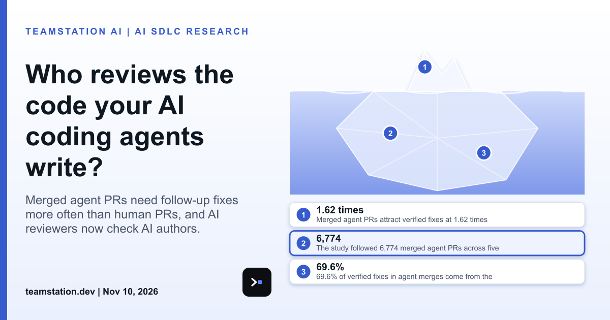

# Who reviews the code your AI coding agents write?

Quick engineering note on today's article. Right now, other AI agents are increasingly the ones reviewing the code your AI coding agents write, and a human shows up later, if at all. Here's the part that stuck with me: merged isn't finished.

Takerngsaksiri, Duong and Barnett followed 6,774 merged agent PRs across five AI coding agents and set them against 5,044 contemporaneous human PRs. Merged agent PRs attract verified fixes at 1.62 times the odds of merged human PRs in the same repositories over the same period. Of the verified fixes in agent merges, 69.6% come from the same agent, and 76.4% of verified fix PRs are agent-authored throughout all commits. So the author, the reviewer and the fixer can all be software. That's kinda wild, tbh.

The scale is legit. The dataset holds 248,641 unique AI-attributed PRs that received at least one AI-attributed review. Cross-product AI-to-AI review occurred in approximately 1.6% of identified agent-authored PRs, and its volume increased by more than two orders of magnitude from 2025-Q1 to 2025-Q3. Closed-loop AI-to-AI review is increasing but remains a minority of identified agent activity. The researchers say the impact on software quality is insufficiently understood, so nobody should pretend the answer's settled. One more fyi: CodeRabbit labeled 35.0% of its comments on Claude Code-authored PRs as refactor comments, compared with 10.5% on Copilot-authored PRs, though the difference may reflect the PRs rather than the reviewer.

What it means for a CTO or CIO: you've gotta name an owner for the stretch after the green check. imo, that's the stretch worth closing. Start by tracking verified fixes after merge, and ask who's accountable when the agent that wrote the code also reviewed it. It's super easy to skip, and naturally it stays skipped until something breaks.

If you're sizing this, read about [**code review capacity for AI agents**](https://teamstation.dev/research/articles/agentic-ai-review-capacity) and [**how to test AI coding agent skills**](https://teamstation.dev/research/articles/agentic-ai-sdlc-test-skills-your-team-ships).

Full article: <https://www.linkedin.com/pulse/who-reviews-code-your-ai-coding-agents-write-teamstation-6ywoc/>

#AISDLC #SoftwareEngineering #EngineeringLeadership
