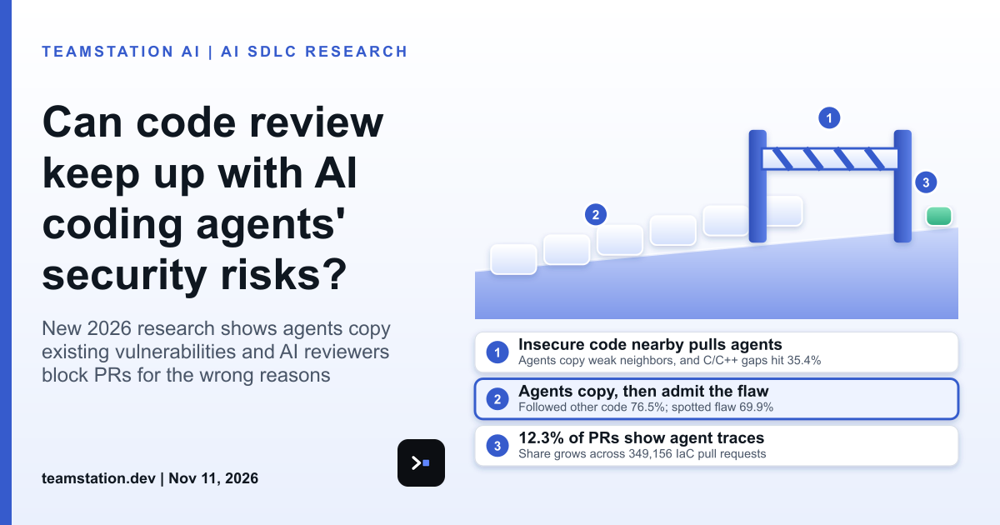

# Green checks aren't evidence: code review meets coding agents

Today's LinkedIn article asks a blunt question: can code review keep up with AI coding agents' security risks? My answer's no, not if your review still treats a green check as gospel. Full piece here: <https://www.linkedin.com/pulse/can-code-review-keep-up-ai-coding-agents-security-risks-teamstation-z27pc/>

Here's what the research says, and imo it's kinda alarming. Insecure existing code makes coding agents write vulnerable code more often. Insecure neighbors reduce the share of correct and secure backend implementations by 3.4% on average, and in C/C++ repository-level coding the average gap between secure and insecure contexts reaches 35.4%. Asked to explain their choices, agents said they were following another code site in 76.5% of cases, even though they recognized the vulnerability they'd introduced in 69.9% of cases. Telling them to be careful about security helps. It doesn't stop the spread.

Infrastructure is where this gets legit uncomfortable. Across 349,156 IaC pull requests from 49,241 GitHub repositories, 12.3% of the non-bot PRs contain agent traces, and that share keeps growing. Agent IaC PRs run way larger than human PRs and modify core infrastructure modules more often. Silent-agent PRs merge at 87.4% overall vs. 78.9% for humans, yet within the same repositories they're merged 4.0 percentage points less often.

Now the review bots. On 31 held-out malicious PRs, PRGuard blocked 22/31 and CodeRabbit blocked 24/31. Similar totals, right? But PRGuard identified 22 target vulnerabilities against 16 for CodeRabbit, a 1.38x difference. CodeRabbit found 16/24 when the required evidence sat inside the touched files and 0/7 when validation needed evidence outside them. The authors conclude that verdict-only evaluation can substantially overstate the security value of automated review. Tbh that's the whole story.

What it means for a CTO or CIO: you've gotta grade the work, not the answer. Ask your reviewers, human or bot, to show the evidence behind a pass. Pair that with [**mutation testing AI generated code**](https://teamstation.dev/research/articles/mutation-testing-ai-generated-code) so your tests prove they'd catch a planted bug. A super fast pipeline isn't automatically a safe pipeline.

#AISDLC #DevOps #CTO #EngineeringLeadership
