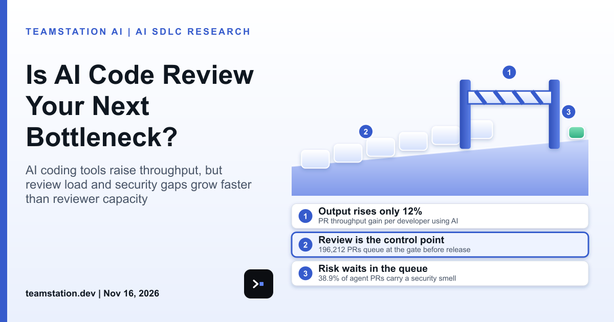

# AI Code Review Is the Bottleneck Nobody Budgeted For

Here's the short version of today's LinkedIn article, Is AI Code Review Your Next Bottleneck? (https://www.linkedin.com/pulse/ai-code-review-your-next-bottleneck-teamstation-zlfmc/). Yes, and tbh it's probably already happening in your org.

AI raises pull request throughput. Nobody argues with that. The cost just lands somewhere else, on the people who have to read, trust and merge the code. If your reviewers feel buried while the delivery dashboards glow green, that mismatch is the tell. We've all seen that movie, and it's kinda exhausting.

Here's what the evidence says. In an enterprise mandate study, PR throughput increased by about 12% when each developer started using AI, and the company reached its target only in the tenth month. The cost of adoption fell on code review: load per reviewer doubled, and automated review exceeded human review in coverage within months. The study used a panel of 802 developers and 196,212 PRs. That's a legit sample, not an anecdote.

Security and quality get weird too. 38.9% of agent-generated PRs contained at least one security smell, and supply chain integrity issues were 82.3% of all detected smells. Human collaborators introduced 67.6% of genuine leaked secrets, and existing automated and human review failed to detect 81.1% of those credentials before integration. So humans aren't off the hook, imo. Fuzz testing of agent-written Linux utilities found the AI code failed less often than human versions, but it had more hangs, such as infinite loops. And in a 5-task SWE-bench Verified pilot, the macro-averaged hidden-test pass rate was 0.80 while strict task resolution was 0.20.

What it means for a CTO or CIO: you gotta treat review capacity as a funded constraint, not a free side effect. fyi, we wrote up [**how to test AI generated code**](https://teamstation.dev/research/articles/mutation-testing-ai-generated-code) and [**agentic engineering code review capacity**](https://teamstation.dev/research/articles/agentic-ai-review-capacity) if you want the mechanics. Measure reviewer load next to throughput. Naturally, a dashboard that only counts merged PRs will keep lying to you, and that's super risky.

#AISDLC #SoftwareEngineering #CTO #DevOps
