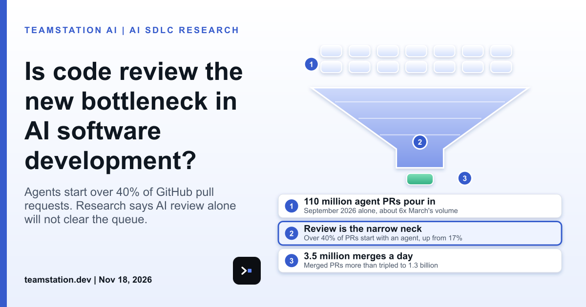

# Engineering note: review is the constraint now

Today's LinkedIn article asks whether code review is the new bottleneck in AI software development. Short answer: yes. Typing got cheap, checking never did, and every agent that opens a pull request slides the check over to a human who was already behind.

The numbers are kinda hard to argue with. By September 2026, more than 40% of pull requests on GitHub started with an agent's first draft, up from 17% in March. Agent started pull requests reached 110 million in September 2026 alone, about 6x March's volume. Merged pull requests more than tripled to 1.3 billion, an average of 3.5 million a day. That's a super lopsided system, because authoring scales with compute and review still scales with people.

Naturally, the first instinct is to throw AI review at the pile. Usage of AI assisted code review and GitHub Advanced Security both grew more than 90% year over year, so plenty of teams did exactly that. Here's the catch. In a survey at a large multinational software company, AI review usage wasn't correlated with less difficulty keeping up with PR volume. So AI review alone isn't sufficient. The same research points at why: AI assisted authoring increases reviewer burden through a lack of author stewardship and through PR volume and size, potentially leading to downstream debt.

What does that mean if you're a CTO or CIO? Imo, there are a few things you've gotta do.

Measure the queue before you fund more generation. If you don't know how long a pull request waits for a reviewer, you're guessing. We wrote about [**measuring review drag before adding headcount**](https://teamstation.dev/research/articles/engineering-review-drag-capacity-balance).

Put stewardship back on the author. An agent's draft isn't done until a named human owns it, and that's a policy call, not a tooling call.

Watch code health, because it shows up in the bill. Across three LLMs running a five agent review and fix pipeline on 465 agent authored pull requests, each CodeHealth point was associated with 3.5% to 6.1% lower token cost. Cleaner code was legit cheaper for the agents to work on. There's more in our piece on the [**cost of fixing AI generated code**](https://teamstation.dev/research/articles/when-does-fixing-ai-code-cost-more-than-writing-it).

Full article: <https://www.linkedin.com/pulse/code-review-new-bottleneck-ai-software-development-teamstation-grntc/>
