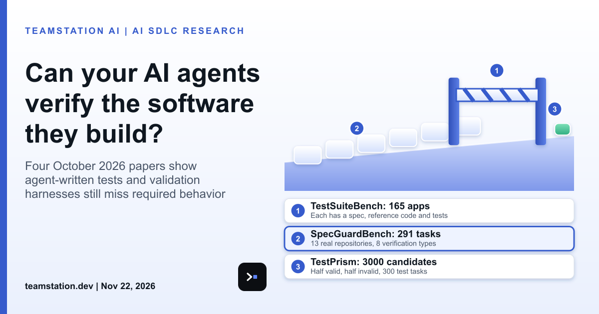

# Agents Build Fast, but Who Checks the Work?

Can your AI agents verify the software they build? Not yet. That's the short answer, and it's kinda uncomfortable for anyone planning a release around agent output.

Here's the research we leaned on. TestSuiteBench covers 165 open source applications, each with a specification, a reference implementation, a reference test suite, and on average 74 mutants. Its authors conclude that agents can build software they can't verify, and that this limits fully autonomous development. tbh that line should be taped to a few roadmap decks.

SpecGuardBench digs into why. It has 291 tasks from 13 real world repositories, covering 8 types of verification logic. Agents tend to write checks that mirror the reference implementation instead of the specification, so they reject implementations the specification permits. That's a legit failure mode: the suite looks green, strict and thorough, and it's grading against the wrong thing.

TestPrism uses 300 test tasks from 17 sources and 3000 candidate implementations, split evenly between valid and invalid solutions, to test generated tests beyond a single reference solution. TestJack reports that fixed unit tests check only part of a task, so agents can pass every test and still miss required behavior or reward hack the evaluator.

What it means for a CTO or CIO: you gotta separate the agent that builds from the thing that judges. imo a few habits help. Measure agent written tests with [**mutation testing for AI written code**](https://teamstation.dev/research/articles/mutation-testing-ai-generated-code). Treat agent skills like code and test them, which is the point of our guide on [**how to test AI agent skills**](https://teamstation.dev/research/articles/agentic-ai-sdlc-test-skills-your-team-ships). And keep a human owner on the specification, because that's the one artifact the agent can't grade for you.

fyi, naturally none of this means slowing down. It means the release gate shouldn't be written by the thing being released.

Full article: <https://www.linkedin.com/pulse/can-your-ai-agents-verify-software-build-teamstation-8ehzc/>
