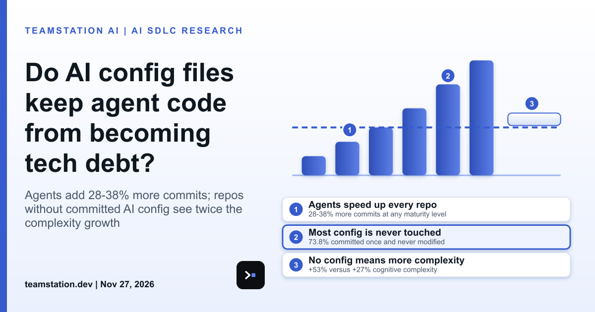

# Engineering note: AI config files are guardrails, not cures

Here's the short version of today's LinkedIn article for CTOs and CIOs. Partly, yes. Repositories with committed AI configuration absorbed far less quality damage after agents arrived. The evidence is observational, though, so it's a strong signal and not a guarantee. Guardrail, not magic wand.

What the data says. Across 441 repositories, the RAMP maturity levels behave as a cumulative scale, and independent human annotation reproduces RAMP's repository-level labels on 97% of a held-out sample. Agents speed everybody up regardless of maturity (28-38% more commits). But among agent-first repositories, the ones without committed AI configuration show roughly twice the increase in cognitive complexity (+53% versus +27%) and 1.7x the increase in static-analysis warnings.

Now the caveat, and tbh it matters. The authors flag that correlated engineering discipline or model capability may explain part of the gap, and they present the findings as hypothesis-generating. Also, 73.8% of AI configuration artifacts are committed once and never modified. That's kinda the tell: a config file nobody maintains is a legit souvenir, not a control.

Another thing, fyi. In a gated spec-driven Claude Code workflow, the orchestrator that runs and judges its own checks recorded undeclared changes in 11 of 247 block checks and stopped work in only four. Letting the agent grade its own homework isn't oversight. You've gotta separate the doer from the judge.

So what do you do Monday morning? Treat config as versioned, reviewed infrastructure. Then look hard at [**human code review capacity for AI agents**](https://teamstation.dev/research/articles/agentic-ai-review-capacity), because a synthesis of research through September 2026 argues the central question is how much production-qualified value a system delivers per dollar, per reviewer-hour, and per unit of operational risk. And check [**how to test coding agent skills**](https://teamstation.dev/research/articles/agentic-ai-sdlc-test-skills-your-team-ships) before you trust them. Imo that's super practical, and naturally it beats arguing about prompts.

Read the full article: <https://www.linkedin.com/pulse/do-ai-config-files-keep-agent-code-from-becoming-tech-debt-rd7ec/>

#AISDLC #SoftwareEngineering #CTO
