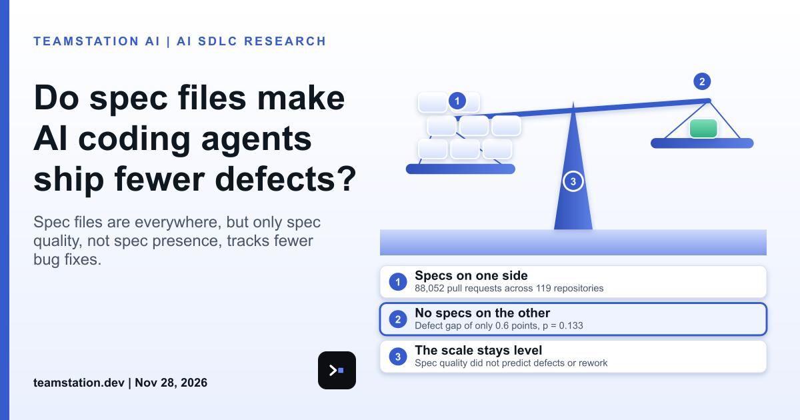

# Spec files aren't a defect lever on their own

If you're a CTO or CIO, here's the short version: in my read of Brenn Hill's matched study of open-source pull requests, changes with specs and changes without them were indistinguishable on defect introduction. Specs can still earn their keep, but the artifact isn't the lever, whatever the vendor deck says. Full article: <https://www.linkedin.com/pulse/do-spec-files-make-ai-coding-agents-ship-fewer-defects-teamstation-8faec/>

Here's what the study reports. Across 88,052 pull requests in 119 open-source repositories, it tested five hypotheses derived from spec-driven development vendor claims. After propensity score matching, pull requests with and without specs were indistinguishable in defect introduction (-0.6 percentage points, p = 0.133). Specification quality predicted neither defects (p = 0.164) nor rework (p = 0.860), and specs didn't constrain the scope of AI-tagged changes (p = 0.997).

That's kinda sobering, tbh. You've probably sat through the pitch. A spec file shows up, and the defects supposedly drop. The data doesn't back it.

There's a more hopeful thread, though. EPIC researchers scored the artifacts of 114 open-source spec-driven development repositories against ISO/IEC/IEEE 29148. The EPIC framework has 40 practices in 10 quality dimensions for making expectations and decisions explicit in specs, plans, and tasks for coding agents. Repositories in the top third of specification quality spent 11.8% of commits on bug fixes versus 20.4% in the bottom third, with a median of 4x as many contributors. Naturally, that's an association, and imo you gotta read it that way.

Practitioners described spec-code checks mainly when changes are completed rather than over time, and implementation detail in specs may help agents while making specs prone to decay. So here's a legit question for your next review: who checks the spec against the code after merge, not just at completion? It's super easy to ask and kinda hard to staff. fyi, I'd pair this with [**how context loss drives engineering rework**](https://teamstation.dev/research/articles/context-loss-rework-distributed-engineering).

#AISDLC #SoftwareEngineering #CTO
